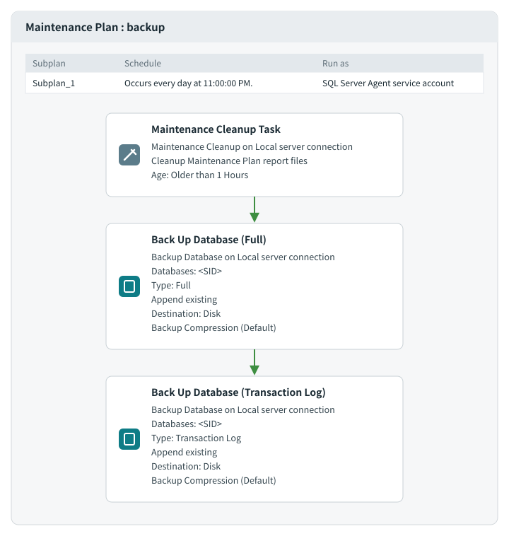

# MSSQL 백업 구성 및 오래된 백업 자동 삭제

MSSQL 서버에서 Maintenance Plan으로 매일 Full·Log 백업을 받고, SQL Agent Job으로 지난 백업 파일을 자동 삭제하도록 구성했습니다.

## 환경

- Microsoft SQL Server 2019 (Windows Server), SAP 시스템 DB

## 배경

백업 디스크 공간이 부족해서, 전날 백업은 지우고 당일 백업만 보관하도록 바꿨습니다.

## 구성

### 1. Maintenance Plan

매일 23:00에 SQL Server Agent 서비스 계정으로 실행합니다.



| 순서 | 작업 | 설정 |
|---|---|---|
| 1 | Maintenance Cleanup Task | Plan 리포트 파일 정리 (1시간 경과분) |
| 2 | Back Up Database (Full) | Disk, 압축 기본값 |
| 3 | Back Up Database (Transaction Log) | Disk, 압축 기본값 |

### 2. SQL Agent Job `delete_backup`

하루 1회, 백업이 끝난 뒤 실행합니다. 1시간이 지난 `bak`(Full), `ldf`(Log) 파일을 삭제하므로, 그 결과 디스크에는 당일 백업만 남습니다.

스크립트: [delete_backup.sql](delete_backup.sql)

```sql
DECLARE @date datetime
SET @date = DATEADD(HOUR, -1, GETDATE())

EXECUTE master.dbo.xp_delete_file 0,N'D:\Backup',N'bak',@date,1
EXECUTE master.dbo.xp_delete_file 0,N'D:\Backup',N'ldf',@date,1
```

| 인자 | 값 | 의미 |
|---|---|---|
| 파일 유형 | `0` | 백업 파일 |
| 폴더 / 확장자 | `D:\Backup` / `bak`, `ldf` | 삭제 대상 |
| 기준 일시 | `@date` | 현재 - 1시간 이전에 만든 파일 |
| 하위 폴더 | `1` | 1단계 하위 폴더 포함 |

<!--
## 주의점

- 삭제 Job은 백업과 별도로 실행되므로, 백업이 실패한 날은 남는 백업이 없을 수 있습니다. 백업 Job에 실패 알림을 설정해 두는 것이 좋습니다.
- 로그 백업이 하루 1회라, 복구 모델이 FULL이면 장애 시 최대 하루치 데이터 손실이 생길 수 있습니다.
-->
